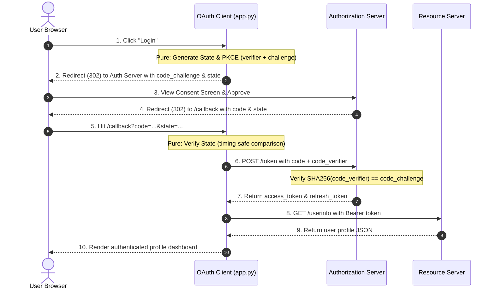

# OAuth 2.0 & PKCE Functional Prototype in Python

A zero-dependency, production-grade prototype demonstrating **OAuth 2.0 Authorization Code Grant with PKCE** (RFC 6749 & RFC 7636) built using **Functional Programming** principles in Python.

---

## 🎯 Key Highlights

- **Pure Functional Architecture**: Mathematical and transformation logic is pure, immutable, and side-effect free.
- **PKCE Security (RFC 7636)**: Implements SHA-256 code verifier/challenge generation without third-party dependencies.
- **Embedded Mock OAuth Provider**: Includes a built-in mock authorization & resource server so you can test the full OAuth flow locally in seconds with **zero external credentials**.
- **Real Provider Presets**: Ready-to-use configurations for **GitHub** and **Google** via environment variables.
- **Zero External Dependencies**: Runs entirely on the Python 3.9+ standard library (`hashlib`, `secrets`, `urllib`, `http.server`).
- **Functional Error Handling**: Uses an immutable `Result[T, E]` (`Success` / `Failure`) monad pattern to avoid unhandled runtime exceptions.

---

## 📐 Functional Architecture

This prototype strictly separates **pure business logic** from **side effects** (I/O):

```
                        ┌───────────────────────────────────────┐
                        │   Pure Core (oauth_core.py)           │
                        │   - generate_pkce_pair()              │
                        │   - compute_code_challenge()          │
                        │   - generate_secure_state()           │
                        │   - build_authorization_url()         │
                        │   - verify_state()                    │
                        │   - parse_token_response()            │
                        │   - pipe() composition                │
                        └──────────────────┬────────────────────┘
                                           │
         ┌─────────────────────────────────┴─────────────────────────────────┐
         ▼                                                                   ▼
┌───────────────────────────────────────┐   ┌───────────────────────────────────────┐
│   Isolated I/O (oauth_client.py)      │   │   Mock Server (mock_server.py)        │
│   - exchange_code_for_token()         │   │   - GET  /mock-oauth/authorize        │
│   - fetch_user_profile()              │   │   - POST /mock-oauth/approve          │
│   - refresh_access_token()            │   │   - POST /mock-oauth/token            │
│   Returns: Result[T, E]               │   │   - GET  /mock-oauth/userinfo         │
└──────────────────┬────────────────────┘   └───────────────────────────────────────┘
                   │
                   ▼
┌───────────────────────────────────────────────────────────────────────────────────┐
│   Client Application (app.py)                                                     │
│   - GET /login      -> builds auth URL & state redirect                           │
│   - GET /callback   -> state verification, token exchange, profile fetch          │
│   - POST /refresh   -> refreshes access token                                     │
│   - POST /logout    -> clears session                                             │
└───────────────────────────────────────────────────────────────────────────────────┘
```

### Functional Programming Concepts Used

1. **Pure Functions**: Functions like `compute_code_challenge` and `verify_state` depend only on their inputs and produce no side effects.
2. **Immutable Data**: Configuration and state models (`OAuthConfig`, `PKCEPair`, `TokenResponse`, `UserProfile`) use `@dataclass(frozen=True)`.
3. **Explicit Error Monad (`Result[T, E]`)**: Instead of raising exceptions, functions return `Success(value)` or `Failure(error)` with `.map()` and `.bind()` chaining.
4. **Function Composition (`pipe`)**: Clean pipelines using `pipe(input, f1, f2, f3)`.

---

## 🔄 OAuth 2.0 + PKCE Flow Diagram



---

## 🚀 Quickstart Guide

### 1. Run the Terminal Demo (Instant Inspection)

To see the pure functional pipeline and cryptographic transformations in the terminal:

```bash
python3 demo_cli.py
```

Output highlights:
- Generates high-entropy PKCE verifier and challenge (RFC 7636).
- Builds authorization URL with state parameter.
- Tests constant-time state validation against tampered tokens.
- Executes functional pipeline composition with `pipe()`.

---

### 2. Run the Interactive Web Application

Start the local server (hosts both client dashboard and embedded mock provider):

```bash
python3 app.py
```

Open your browser to:
👉 **[http://localhost:8000](http://localhost:8000)**

1. Click **Local Mock Provider**.
2. Review the consent screen and click **Authorize Application**.
3. See your authenticated session, claims, and acquired tokens.
4. Click **Refresh Access Token** to test the refresh grant.

---

### 3. Running Unit Tests

Run the full test suite (including RFC 7636 Appendix B test vector verification):

```bash
python3 -m unittest discover -s tests
```

---

## 🌐 Connecting Real Providers (Optional)

To test against GitHub or Google, create a `.env` file or export environment variables:

### GitHub OAuth
1. Create an OAuth App at [GitHub Developer Settings](https://github.com/settings/developers).
2. Set Authorization callback URL to: `http://localhost:8000/callback`.
3. Set environment variables:
   ```bash
   export GITHUB_CLIENT_ID="your_client_id"
   export GITHUB_CLIENT_SECRET="your_client_secret"
   ```

### Google OAuth (OpenID Connect)
1. Create credentials at [Google Cloud Console](https://console.cloud.google.com/apis/credentials).
2. Set Authorized redirect URI to: `http://localhost:8000/callback`.
3. Set environment variables:
   ```bash
   export GOOGLE_CLIENT_ID="your_google_client_id"
   export GOOGLE_CLIENT_SECRET="your_google_client_secret"
   ```

---

## 📁 Project Structure

```
prototypes/Oauth2.0/
├── README.md             # Documentation, concepts, and architectural guide
├── .env.example          # Environment variables template
├── requirements.txt      # Dependency notes (zero dependencies required)
├── config.py             # Immutable configuration types & provider presets
├── oauth_core.py         # Pure functional core: PKCE, State, Auth URLs, Result monad
├── oauth_client.py       # Isolated network I/O: Token exchange, profile, refresh
├── mock_server.py        # Embedded Mock OAuth 2.0 Authorization & Resource server
├── app.py                # Functional web application client & dashboard
├── demo_cli.py           # CLI walkthrough of the functional OAuth pipeline
└── tests/
    ├── __init__.py
    └── test_oauth.py     # Unit tests (RFC 7636 test vectors, state, parsers)
```

